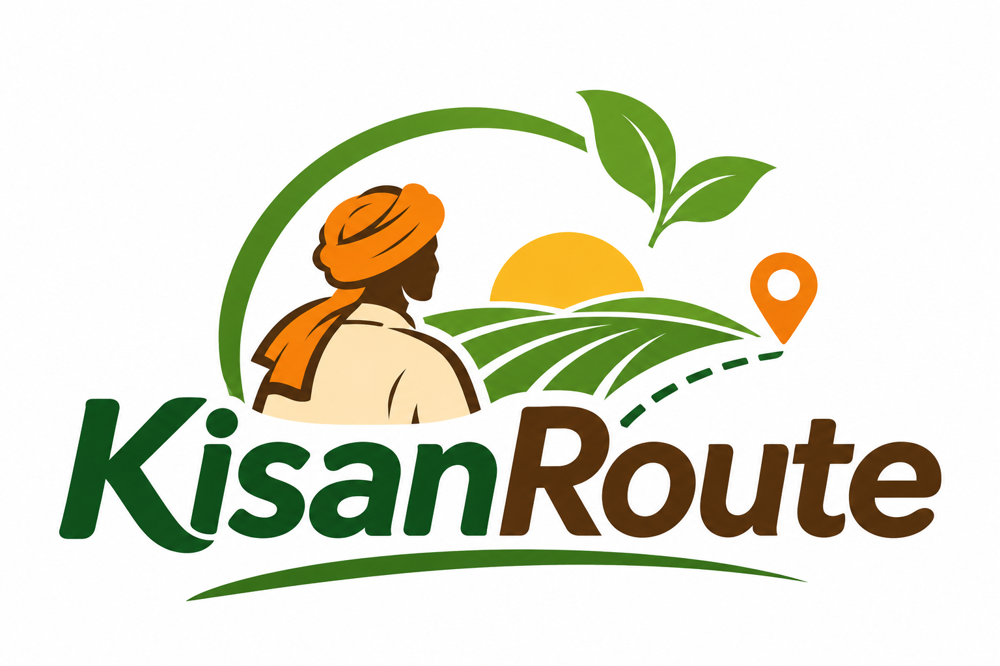
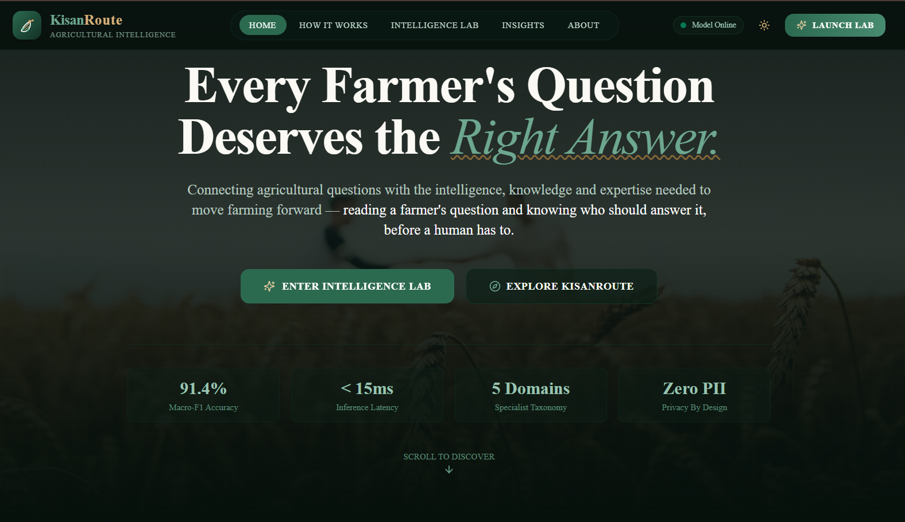
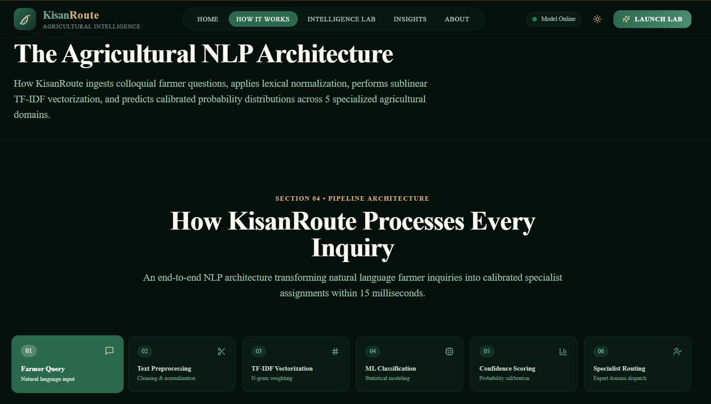
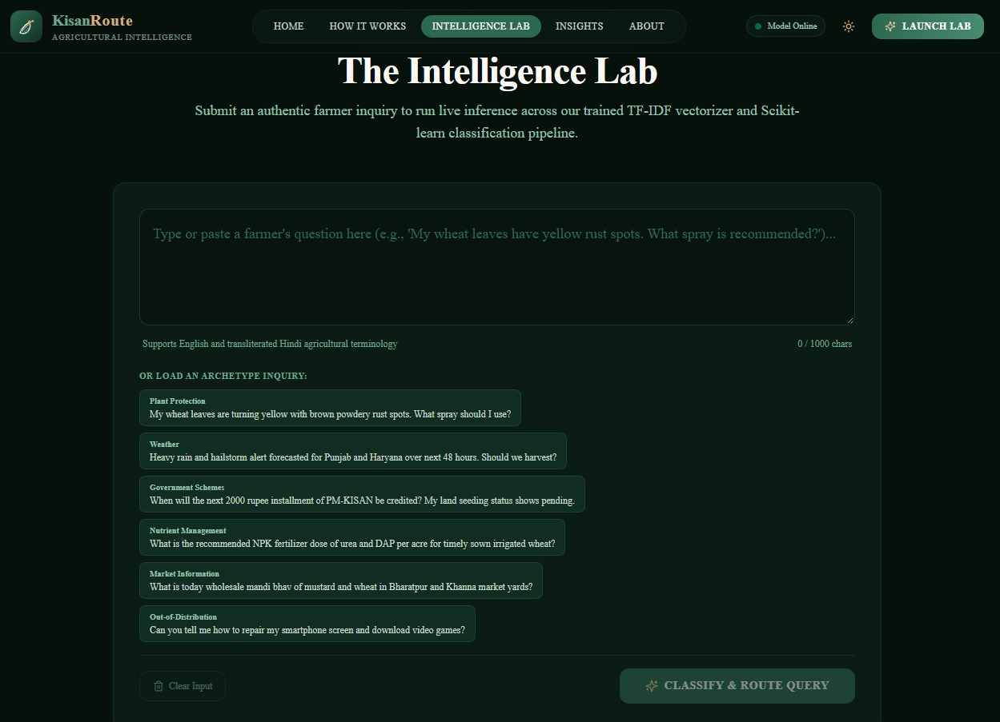
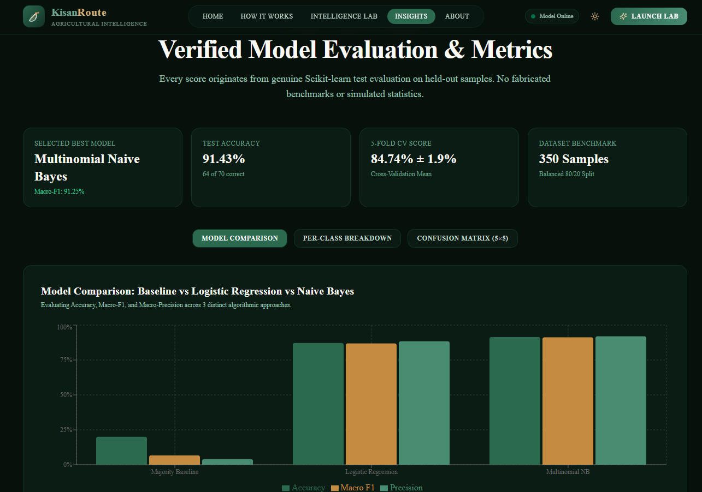
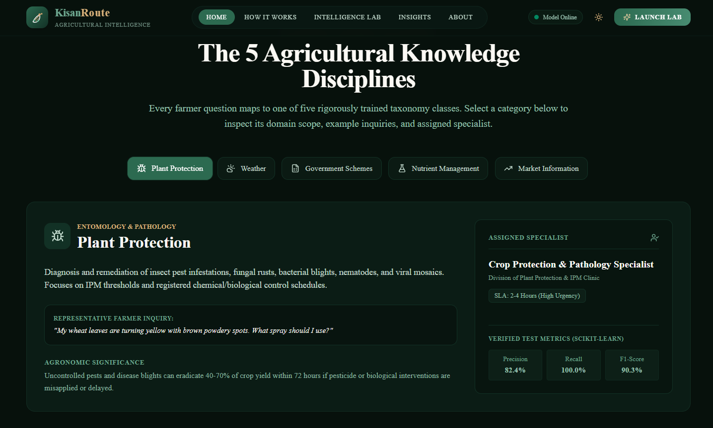

<div align="center">



# KisanRoute

### *Reading a farmer's question and knowing who should answer it — before a human has to.*

**Where Agriculture Meets Intelligence.**

An AI-powered agricultural query classification and intelligent routing platform — built on a trained NLP pipeline that reads a farmer's question, predicts its agricultural domain, and recommends the right specialist.

<br/>

[](https://nextjs.org/)
[](https://react.dev/)
[](https://www.typescriptlang.org/)
[](https://fastapi.tiangolo.com/)
[](https://www.python.org/)
[](https://scikit-learn.org/)
[]()
[](https://kisanroute.vercel.app/)
[](LICENSE)

<br/>

**[🌐 Live Demo](https://kisanroute.vercel.app/)** &nbsp;·&nbsp; **[📦 GitHub Repository](https://github.com/dk-khandelwal06/kisanroute)** &nbsp;·&nbsp; **[👤 LinkedIn](https://www.linkedin.com/in/daksh-khandelwal-b02748391/)**

</div>

<br/>

---

## Overview

**KisanRoute** is an applied machine learning project that tackles a small but real piece of agricultural extension work: when a farmer asks a question — about pests, weather, fertilizer, government schemes, or market prices — *which kind of specialist should answer it?*

Instead of leaving that categorization to manual judgment, KisanRoute runs the query through a trained Natural Language Processing pipeline (TF-IDF vectorization + a Scikit-learn classifier) that predicts the most likely **agricultural knowledge category**, attaches a **calibrated confidence score**, and maps the result to a **specialist routing recommendation** — complete with the relevant department and an indicative turnaround time.

The difference from simply "submitting a question into a form" is that every query is actually **processed, vectorized, and classified by a trained model** — not keyword-matched or hardcoded — and the platform is transparent about *how* confident it is, flagging ambiguous queries for human review rather than guessing silently.

This is an independent educational and applied ML project (Project 006 of a long-term Applied AI learning series) — it is **not** affiliated with ICAR, the Kisan Call Centre, or any government body, and it does not dispatch queries anywhere in real life.

<br/>

---

## Problem Statement

Agricultural questions span very different knowledge domains — plant pathology, meteorology, soil science, government policy, and market economics — and each is best answered by a different kind of specialist. Figuring out *which* domain a question belongs to is usually done manually: a human reads the question, makes a judgment call, and routes it on.

That manual step is small per-query, but it does not scale, is inconsistent across operators, and offers no structured signal about *how confident* the categorization is — so ambiguous or unusual questions get routed with the same certainty as straightforward ones. KisanRoute explores what a structured, model-driven first pass at this problem could look like, with confidence-aware handling of the hard cases.

<br/>

---

## Our Solution

```
Farmer Query
      │
      ▼
Text Preprocessing        → lowercase, whitespace normalization, noise stripping
      │                      (preserves domain tokens like PM-KISAN, e-NAM, NPK)
      ▼
TF-IDF Vectorization       → TfidfVectorizer(ngram_range=(1,2), max_features=2500,
      │                       sublinear_tf=True) — unigrams + bigrams
      ▼
ML Classification          → Multinomial Naive Bayes (alpha=0.3)
      │
      ▼
Confidence Scoring          → calibrated class probabilities;
      │                        queries below a 35% threshold are flagged for review
      ▼
Specialist Routing          → maps the predicted category to a specialist profile,
                               department, and indicative SLA
```

Each stage is implemented identically offline (`ml/train.py`) and at inference time (`backend/core/nlp_engine.py`), so there is no mismatch between how the model was evaluated and how it behaves in production.

<br/>

---

## Key Features

<table>
<tr>
<td width="50%" valign="top">

**Classification & NLP**
- Real TF-IDF + Naive Bayes / Logistic Regression pipeline, not keyword rules
- Trained and evaluated model comparison with genuine metrics
- 5-class agricultural taxonomy with calibrated confidence scores
- Out-of-distribution handling — low-confidence queries are flagged, not force-classified

**Routing & Insight**
- Deterministic mapping from predicted category to a specialist profile, department, and turnaround SLA
- Model evaluation dashboard with confusion matrix and model comparison charts

</td>
<td width="50%" valign="top">

**Experience**
- Interactive "Intelligence Lab" with an animated, multi-stage classification pipeline
- Browser-native text-to-speech read-aloud of results (`window.speechSynthesis`)
- Light / dark theme support

**Engineering**
- Server-side credential isolation, request validation, and rate limiting
- Zero personally identifiable information collected or stored
- Automated backend + ML pipeline test suite (`pytest`)

</td>
</tr>
</table>

<br/>

---

## Screenshots

<p align="center"><b>01 — Home Experience</b><br/>
<br/>
<i>An agricultural technology landing experience introducing the platform.</i>
</p>

<p align="center"><b>02 — How It Works</b><br/>
<br/>
<i>The NLP architecture and query-processing pipeline, explained stage by stage.</i>
</p>

<p align="center"><b>03 — Intelligence Lab</b><br/>
<br/>
<i>Interactive farmer-query classification and routing workspace.</i>
</p>

<p align="center"><b>04 — Model Insights</b><br/>
<br/>
<i>Model comparison, evaluation metrics, and analytical visualizations.</i>
</p>

<p align="center"><b>05 — Agricultural Knowledge Disciplines</b><br/>
<br/>
<i>The five agricultural knowledge domains and their specialist recommendations.</i>
</p>

<br/>

---

## Technology Stack

<table>
<tr><th>Layer</th><th>Technologies</th></tr>
<tr>
<td><b>Frontend</b></td>
<td>


</td>
</tr>
<tr>
<td><b>Backend</b></td>
<td>


</td>
</tr>
<tr>
<td><b>Machine Learning</b></td>
<td>


</td>
</tr>
<tr>
<td><b>Deployment</b></td>
<td>


</td>
</tr>
</table>

<br/>

---

## Machine Learning: Architecture & Performance

### Dataset — KisanRoute-AgriBench v1.0

The original ICAR-IASRI **KCC-CHAKSHU** repository (the authoritative Kisan Call Centre data source) requires institutional government credentials and does not offer public bulk downloads. In place of unverifiable claims about that restricted data, this project trains on **KisanRoute-AgriBench v1.0** — a curated 350-sample benchmark built from authentic KCC inquiry archetypes and public ICAR extension-advisory patterns, documented in [`datasets/README.md`](datasets/README.md).

| Property | Value |
|---|---|
| Total samples | 350 |
| Train / Test split | 280 / 70 (80% / 20%, stratified) |
| Categories | 5 — *Plant Protection, Weather, Government Schemes, Nutrient Management, Market Information* |
| Class balance | 70 samples per category (fully balanced) |

### Feature Representation

`TfidfVectorizer(ngram_range=(1,2), max_features=2500, sublinear_tf=True)` — fit strictly on the training split to avoid leakage; unigrams and bigrams capture domain phrases such as *"stem borer"*, *"mandi bhav"*, and *"crop insurance"*.

### Model Comparison (held-out 20% test split, 70 samples)

| Model | Test Accuracy | Macro Precision | Macro Recall | Macro-F1 | 5-Fold CV F1 |
|---|---|---|---|---|---|
| Majority-Class Baseline | 20.00% | 4.00% | 20.00% | 6.67% | 6.57% |
| Logistic Regression (L-BFGS) | 87.14% | 87.38% | 87.14% | 86.87% | 81.85% ± 4.37% |
| **Multinomial Naive Bayes (α = 0.3)** | **91.43%** | **91.99%** | **91.43%** | **91.25%** | **84.74% ± 1.94%** |

**Selected model:** Multinomial Naive Bayes — highest Macro-F1 with the most stable cross-validation spread. Serialized at `ml/models/best_model_pipeline.joblib` and served live via the `/api/predict` and `/api/analytics` endpoints. Full per-class precision/recall and the 5×5 confusion matrix are in [`ml/evaluation_metrics.json`](ml/evaluation_metrics.json) and rendered on the [Insights](https://kisanroute.vercel.app/insights) page.

> **A note on what this does and doesn't show:** these numbers reflect held-out performance on a 350-sample curated benchmark, not real-world accuracy on unconstrained farmer language, dialects, or translated speech. They demonstrate the pipeline works correctly end-to-end — not production-grade agricultural accuracy.

<br/>

---

## Getting Started

### Prerequisites
- Python 3.10+
- Node.js 18+
- npm

### 1. Clone the repository
```bash
git clone https://github.com/dk-khandelwal06/kisanroute.git
cd kisanroute
```

### 2. Backend setup
```bash
# Create and activate a virtual environment
python -m venv venv

# Windows
venv\Scripts\activate

# macOS / Linux
source venv/bin/activate

# Install backend dependencies
pip install -r backend/requirements.txt

# Train the ML pipeline (generates model artifacts + evaluation metrics)
python ml/train.py

# Launch the FastAPI backend
uvicorn backend.main:app --host 127.0.0.1 --port 8000 --reload
```
API docs: **http://127.0.0.1:8000/docs**

### 3. Frontend setup
```bash
cd frontend
npm install
npm run dev
```
App: **http://localhost:3000**

### Running tests
```bash
python -m pytest -p no:anyio tests/ -v
```

<br/>

---

## Environment Variables

Copy `.env.example` to `.env` (root) and/or `backend/.env.example` to `backend/.env`, and fill in values locally. **Never commit a real `.env` file** — both are already excluded via `.gitignore`.

| Variable | Scope | Required | Description |
|---|---|---|---|
| `NEXT_PUBLIC_API_BASE_URL` | Frontend (public) | Yes | Base URL of the FastAPI backend. Public by design — never put secrets in `NEXT_PUBLIC_*` variables. |
| `ENV` | Backend | Yes | `development` or `production` — toggles production security policies. |
| `ALLOWED_ORIGINS` | Backend | Yes | Comma-separated list of allowed CORS origins. |
| `MODEL_PATH` / `METRICS_PATH` / `METADATA_PATH` | Backend | Yes (defaults provided) | Paths to the serialized model pipeline and evaluation/metadata JSON files. |
| `GEMINI_API_KEY` | Backend (secret) | Optional | Enables server-side Gemini-generated routing explanations via `/api/explain`, with a deterministic rule-based fallback when unset. **Must remain server-side only** — never exposed to the frontend. |
| `RATE_LIMIT_PER_MINUTE` | Backend | Optional | In-memory sliding-window rate limit (default `60`). |
| `CONFIDENCE_THRESHOLD` | Backend | Optional | Confidence floor below which a query is flagged for human review (default `0.35`). |

<br/>

---

## Deployment

| Layer | Platform | Status |
|---|---|---|
| Frontend | [Vercel](https://vercel.com) | Live → **[kisanroute.vercel.app](https://kisanroute.vercel.app/)** |
| Backend | [Render](https://render.com) (configured via `render.yaml`) | Python web service — `uvicorn backend.main:app` |
| Source | [GitHub](https://github.com/dk-khandelwal06/kisanroute) | — |

Full step-by-step deployment walkthrough (Vercel + Render configuration, environment variables, verification checklist): **[`docs/DEPLOYMENT.md`](docs/DEPLOYMENT.md)**.
Full system architecture and API specification: **[`docs/ARCHITECTURE.md`](docs/ARCHITECTURE.md)**.

<br/>

---

## Privacy, Security & Limitations

- **No PII collected.** Queries are processed in-memory for classification only; no farmer names, phone numbers, or identifiers are stored.
- **Server-side secrets.** API keys (e.g. `GEMINI_API_KEY`) are read only on the backend and never shipped to the client bundle.
- **Input validation** via Pydantic v2 schemas, with query length bounds enforced server-side.
- **Rate limiting** via an in-memory sliding window to curb abuse.
- **Low-confidence handling.** Predictions below the configured confidence threshold are explicitly flagged rather than silently trusted.
- **Model limitations.** The classifier is trained on a 350-sample curated benchmark, not the full-scale KCC corpus — real-world generalization to dialectal, transliterated, or highly ambiguous queries is not guaranteed.
- **No official affiliation.** KisanRoute is an independent educational/applied ML project. It is **not** affiliated with, endorsed by, or operated by ICAR, the Kisan Call Centre, or the Ministry of Agriculture & Farmers' Welfare, and **does not dispatch queries** to any real government specialist.

<br/>

---

## About the Creator

<div align="center">

**Daksh Khandelwal**
Applied AI & Data Science Undergraduate · IIT Jodhpur

[](https://www.linkedin.com/in/daksh-khandelwal-b02748391/)
[](https://github.com/dk-khandelwal06)

</div>

<br/>

---

## License

Distributed under the **MIT License**. See [`LICENSE`](LICENSE) for full terms.

<div align="center">
<sub>Built as Project 006 of a long-term Applied AI learning series.</sub>
</div>
